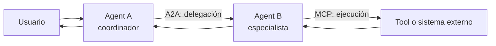
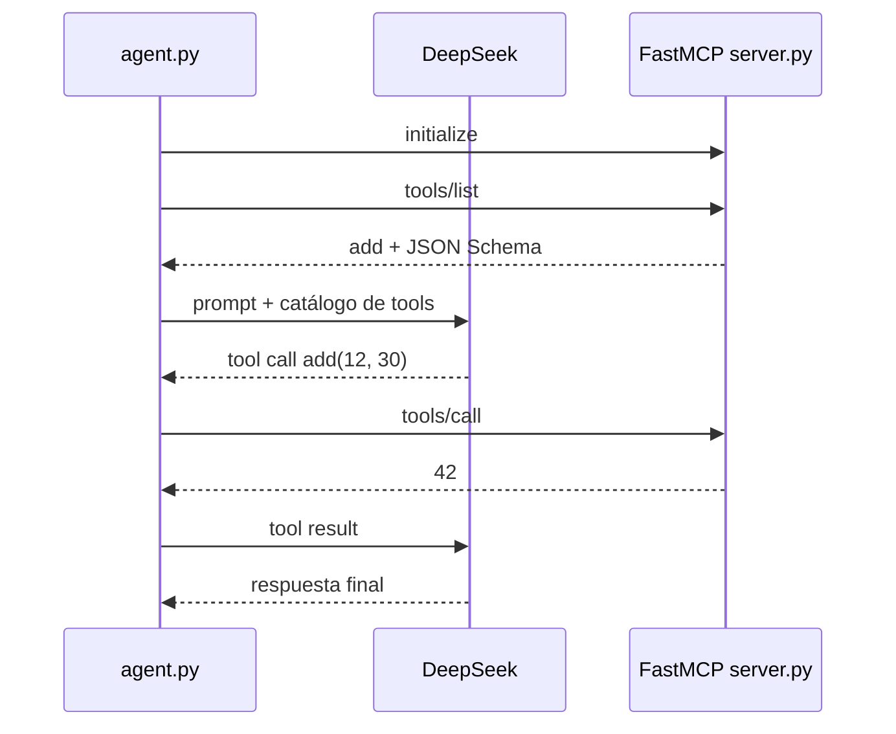
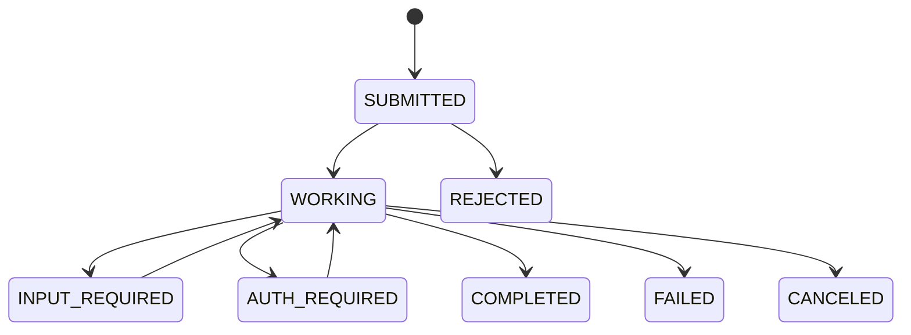
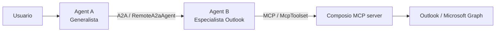

# Sesión 05 — MCP y A2A

Esta sesión estudia dos protocolos complementarios para construir sistemas de
agentes interoperables:

- **MCP (Model Context Protocol)** conecta una aplicación agente con
  capacidades: tools, resources y prompts.
- **A2A (Agent2Agent Protocol)** conecta agentes independientes para que
  descubran capacidades, intercambien mensajes y coordinen trabajo rastreable.

[Ver la presentación de la sesión](./sesion-05-mcp-a2a.pptx)

## Objetivos

Al terminar la sesión deberías poder:

1. explicar qué problema resuelve MCP y qué problema resuelve A2A;
2. leer una Agent Card y entender sus Agent Skills;
3. seguir el ciclo de vida de una Task A2A;
4. distinguir polling, streaming y push notifications;
5. ubicar al `AgentExecutor`, el request handler, la event queue y el task store;
6. reconocer dónde termina A2A y dónde empieza MCP en el ejemplo integrador.

## La idea central: profundidad y alcance

MCP y A2A no compiten. Se ubican en límites diferentes.

| | MCP | A2A |
|---|---|---|
| Pregunta principal | ¿Cómo usa el agente una capacidad externa? | ¿Cómo delega trabajo a otro agente? |
| Relación | Aplicación agente ↔ servidor de capacidades | Agente cliente ↔ agente remoto |
| Contrato visible | Tools, resources y prompts | Agent Card, skills, messages, tasks y artifacts |
| Unidad operativa | Llamada a una tool o lectura de un recurso | Message o Task con estado |
| Implementación interna | El servidor oculta cómo implementa la capacidad | El agente remoto oculta modelo, memoria, tools y framework |
| Foco de la sesión | Descubrir y ejecutar tools | Descubrir agentes y seguir trabajo remoto |



La documentación oficial de A2A resume esta relación como **MCP para
profundidad** y **A2A para alcance**.

## MCP: una interfaz común para capacidades

### Arquitectura

Un sistema MCP tiene tres roles:

- **Host**: la aplicación agente. Posee la experiencia de usuario, el LLM, la
  política de seguridad y la orquestación.
- **MCP client**: mantiene la conexión con un MCP server y traduce sus contratos
  al formato que usa la aplicación o el modelo.
- **MCP server**: publica primitivas con contratos explícitos.

Las primitivas principales son:

- **Tools**: acciones invocables, por ejemplo sumar números o enviar un email.
- **Resources**: datos direccionables que aportan contexto.
- **Prompts**: plantillas reutilizables que el servidor expone al cliente.

El modelo no “habla MCP” directamente. El client descubre el catálogo MCP,
convierte los schemas al formato de tools del proveedor de LLM y despacha la
llamada elegida.

### Conexión y transporte

MCP usa mensajes JSON-RPC. Un server puede ejecutarse como proceso local sobre
`stdio` o como servicio remoto sobre HTTP. El ejemplo `mcp-minimo` usa
**Streamable HTTP** en:

```text
http://127.0.0.1:8000/mcp
```

### Demo 1: `mcp-minimo`

El ejemplo reduce MCP a una sola tool:

```python
@mcp.tool()
def add(a: int, b: int) -> int:
    return a + b
```

La firma, los tipos y el docstring producen el contrato que el cliente obtiene
mediante discovery. El flujo completo es:

1. `agent.py` abre la conexión HTTP y crea un `ClientSession`.
2. Ejecuta `initialize()` para negociar la sesión usada por esta versión del SDK.
3. Ejecuta `list_tools()` y recibe `add` con su JSON Schema.
4. Convierte el contrato MCP al formato de tools que entiende DeepSeek.
5. El LLM decide llamar `add(12, 30)`.
6. El cliente ejecuta `session.call_tool(...)`.
7. `server.py` devuelve `42` y el resultado vuelve al LLM para redactar la
   respuesta final.



Archivos principales:

- [`mcp-minimo/server.py`](./mcp-minimo/server.py): servidor FastMCP y tool
  `add`.
- [`mcp-minimo/agent.py`](./mcp-minimo/agent.py): client MCP, adaptación de
  schemas y agent loop.
- [`mcp-minimo/README.md`](./mcp-minimo/README.md): explicación línea por línea.

Para ejecutarlo desde la raíz del repositorio:

```powershell
# Terminal 1
python .\w05-mcp-and-a2a\mcp-minimo\server.py

# Terminal 2
python .\w05-mcp-and-a2a\mcp-minimo\agent.py
```

Probá `hola` para una respuesta sin tool y `cuanto es 12 mas 30` para disparar
`tools/call`.

> **Nota de versión.** El ejemplo usa el flujo del SDK `mcp` 1.x fijado por este
> repositorio. La revisión MCP 2026-07-28 introdujo un núcleo stateless y retiró
> `initialize`/`initialized` y las sesiones de protocolo. Para enseñar o migrar
> código, conviene distinguir siempre la versión del ejemplo de la versión más
> reciente de la especificación.

## A2A: un contrato para agentes remotos

En A2A, un agente cliente no necesita conocer el modelo, la memoria, las tools
ni el framework del agente remoto. Necesita conocer su contrato público y un
endpoint compatible.

### Agent Card

La **Agent Card** es el documento de descubrimiento. Normalmente se publica en:

```text
/.well-known/agent-card.json
```

Describe, entre otros datos:

- identidad: nombre, descripción y versión;
- interfaces: URL, binding y versión del protocolo;
- capacidades: streaming, push notifications y card extendida;
- formatos de entrada y salida;
- requisitos de seguridad;
- Agent Skills publicadas.

La card es una declaración de capacidades, no un lugar para credenciales. El
cliente debe validar que confía en el host y aplicar autenticación y autorización
por los mecanismos declarados.

### Agent Skills

Una **Agent Skill** describe una capacidad que el cliente puede solicitar. Suele
incluir:

- `id`, `name` y `description`;
- `tags` para clasificación;
- `examples` para orientar al consumidor;
- `inputModes` y `outputModes` cuando difieren de los defaults del agente.

En el ejemplo básico, la card pública anuncia `echo_bot`. La card extendida
agrega `echo_bot_super_mode` para consumidores autenticados.

### Discovery

Hay tres estrategias habituales:

1. **URI well-known**: el cliente resuelve la card directamente desde el host.
2. **Registro o catálogo curado**: una organización mantiene agentes aprobados.
3. **Configuración directa**: la URL se entrega fuera de banda mediante código,
   configuración o service discovery.

Descubrir una card no equivale a confiar en ella. En producción también hay que
verificar origen, TLS, identidad, permisos y compatibilidad de versión.

## Mensajes, Parts, Artifacts y Tasks

- **Message**: una comunicación con rol y uno o más `Part`.
- **Part**: contenido tipado, por ejemplo texto, archivo o datos estructurados.
- **Artifact**: resultado producido por el agente, también compuesto por parts.
- **Task**: unidad de trabajo rastreable que conserva estado, historial y
  artifacts.

Un intercambio simple puede devolver solamente un `Message`. Cuando el trabajo
es largo, interrumpible, multi-turn o necesita seguimiento, el servidor crea una
`Task`.

### `taskId` y `contextId`

- `taskId` identifica una unidad de trabajo concreta.
- `contextId` agrupa messages y tasks relacionados dentro de la misma
  conversación o contexto de negocio.

Una Task terminal no se reinicia. Si el usuario refina el pedido después de su
finalización, el cliente crea otra Task y puede conservar el mismo `contextId`.

## Ciclo de vida de una Task

Los estados de A2A v1.0 son:

| Estado | Significado | Tipo |
|---|---|---|
| `UNSPECIFIED` | Estado no determinado; normalmente no debería formar parte de un flujo válido | Inicial técnico |
| `SUBMITTED` | El servidor aceptó la Task | No terminal |
| `WORKING` | El agente está procesando | No terminal |
| `INPUT_REQUIRED` | Falta información del usuario o cliente | Interrumpido |
| `AUTH_REQUIRED` | Falta autenticación o autorización | Interrumpido |
| `COMPLETED` | El trabajo terminó correctamente | Terminal |
| `FAILED` | El agente no pudo completar el trabajo | Terminal |
| `CANCELED` | La Task fue cancelada | Terminal |
| `REJECTED` | El agente rechazó el pedido | Terminal |

Los estados interrumpidos permiten continuar la misma Task cuando llega el dato
o la autorización. Los estados terminales cierran esa Task.



## Executor, eventos y persistencia

En el SDK Python de A2A, la ruta conceptual es:

```text
rutas A2A
  → DefaultRequestHandler
    → AgentExecutor.execute(context, event_queue)
      → EventQueue
        → TaskStore y respuesta al cliente
```

El **request handler** valida y traduce operaciones del protocolo. El
**AgentExecutor** adapta la lógica interna del agente a objetos A2A. Sus métodos
principales son:

- `execute(context, event_queue)`: ejecuta el pedido y publica eventos;
- `cancel(context, event_queue)`: intenta cancelar la Task cuando el agente lo
  soporta.

La **EventQueue** desacopla la ejecución interna de la entrega. El executor puede
publicar una Task inicial, actualizaciones de estado y artifacts parciales o
finales. El **TaskStore** permite recuperar el estado con `tasks/get`; en los
ejemplos se usa almacenamiento en memoria.

## Polling, streaming y push

- **Polling**: el cliente consulta `tasks/get` para conocer el estado más
  reciente.
- **Streaming**: `message/stream` mantiene una conexión SSE y entrega eventos
  incrementales. En A2A Python 1.0, un stream de Task emite primero el objeto
  `Task` y luego sus updates.
- **Push notifications**: el servidor llama un webhook del cliente cuando hay
  cambios; es útil para trabajos largos cuando el consumidor no mantiene la
  conexión abierta.
- **Resubscribe**: un cliente que perdió el stream puede volver a suscribirse a
  una Task activa cuando el servidor lo soporta.

Streaming no cambia el modelo de datos: cambia cómo llegan las actualizaciones.

## Demo 2: `a2a` — Hello World con contrato completo

Este ejemplo parte de la demo oficial y separa deliberadamente el protocolo de
la inteligencia del agente. La respuesta está hardcodeada, pero la exposición es
real:

1. `__main__.py` publica la Agent Card pública y la extendida.
2. Starlette expone A2A en `127.0.0.1:9999`.
3. `DefaultRequestHandler` usa `HelloWorldAgentExecutor` e
   `InMemoryTaskStore`.
4. `test_client.py` resuelve la card y prueba `SendMessage` y streaming.
5. El executor publica la Task, `WORKING`, un Artifact y `COMPLETED`.

Archivos:

- [`a2a/__main__.py`](./a2a/__main__.py)
- [`a2a/agent_executor.py`](./a2a/agent_executor.py)
- [`a2a/test_client.py`](./a2a/test_client.py)

Ejecución:

```powershell
# Terminal 1
python .\w05-mcp-and-a2a\a2a\__main__.py

# Terminal 2
python .\w05-mcp-and-a2a\a2a\test_client.py
```

La lección es importante: A2A estandariza el perímetro del agente, aunque la
lógica interna sea trivial.

## Demo 3: `a2a-langgraph` — el protocolo rodea a un agente real

Este ejemplo conserva el mismo perímetro A2A y reemplaza la respuesta fija por
un agente de monedas:

- `CurrencyAgent` usa LangGraph ReAct y Gemini;
- `get_exchange_rate` consulta una API de tasas;
- `MemorySaver` usa `contextId` como hilo de memoria;
- `CurrencyAgentExecutor` transforma los eventos internos en estados y
  artifacts A2A;
- si falta la moneda destino, emite `INPUT_REQUIRED`;
- el cliente responde usando el mismo `taskId` y `contextId`;
- al resolver la consulta, la Task termina en `COMPLETED` con un artifact.

Archivos:

- [`a2a-langgraph/__main__.py`](./a2a-langgraph/__main__.py)
- [`a2a-langgraph/app/agent.py`](./a2a-langgraph/app/agent.py)
- [`a2a-langgraph/app/agent_executor.py`](./a2a-langgraph/app/agent_executor.py)
- [`a2a-langgraph/app/test_client.py`](./a2a-langgraph/app/test_client.py)

Ejecución:

```powershell
# Terminal 1
python .\w05-mcp-and-a2a\a2a-langgraph\__main__.py

# Terminal 2
python .\w05-mcp-and-a2a\a2a-langgraph\app\test_client.py
```

La diferencia está dentro del agente; el consumidor sigue viendo Card, skills,
messages, tasks, estados, events y artifacts.

## Demo 4: `adk-a2a-mcp` — ejemplo integrador

El último ejemplo combina los dos protocolos:



### Agent A: generalista y consumidor A2A

`consuming_agent` usa `RemoteA2aAgent` y descubre al especialista mediante:

```text
http://127.0.0.1:8000/a2a/outlook_agent/.well-known/agent-card.json
```

Su responsabilidad es reconocer que el pedido pertenece al dominio de Outlook
y delegarlo. No conoce la cuenta de Outlook ni la tool MCP concreta.

### Agent B: especialista Outlook y cliente MCP

`outlook_agent` se publica vía A2A. Internamente es un `LlmAgent` de ADK con un
`McpToolset` conectado al servidor MCP de Composio. La configuración restringe
las capacidades a:

```text
OUTLOOK_SEND_EMAIL
```

El agente exige destinatario, asunto, cuerpo e intención explícita de enviar
antes de producir el efecto externo.

### Flujo completo

1. El usuario pide enviar un email.
2. Agent A descubre o usa la Card de Agent B y delega por A2A.
3. Agent B interpreta el pedido dentro de su dominio.
4. Agent B descubre y ejecuta `OUTLOOK_SEND_EMAIL` por MCP.
5. Composio llama Microsoft Graph con la cuenta autorizada.
6. El resultado vuelve por MCP a Agent B y por A2A a Agent A.
7. Agent A presenta el resultado al usuario.

Archivos:

- [`adk-a2a-mcp/consuming_agent/agent.py`](./adk-a2a-mcp/consuming_agent/agent.py)
- [`adk-a2a-mcp/outlook_agent/agent.py`](./adk-a2a-mcp/outlook_agent/agent.py)
- [`adk-a2a-mcp/outlook_agent/agent.json`](./adk-a2a-mcp/outlook_agent/agent.json)
- [`adk-a2a-mcp/README.md`](./adk-a2a-mcp/README.md)

Ejecución desde la raíz:

```powershell
.\.venv\Scripts\adk.exe web --a2a w05-mcp-and-a2a/adk-a2a-mcp
```

El README del ejemplo documenta variables de entorno, Composio, ejecución en
procesos separados y depuración de tasks.

> `mcp-minimo` y ADK Web usan el puerto `8000` por defecto. No los ejecutes al
> mismo tiempo sin cambiar uno de los puertos.

## Límites de confianza del ejemplo integrador

La interoperabilidad separa responsabilidades, pero no elimina los controles:

- **Discovery**: la card publica capacidades y endpoints, nunca secretos.
- **Delegación**: Agent A decide a qué especialista entregar el pedido.
- **Mínimo privilegio**: Composio publica una sola tool y ADK vuelve a filtrarla.
- **Autorización**: la cuenta conectada debe pertenecer al usuario configurado.
- **Confirmación**: un envío de email es un efecto externo y requiere intención
  explícita.
- **Observabilidad**: conviene correlacionar `contextId`, `taskId`, tool call y
  operación externa.
- **Persistencia**: los stores en memoria son didácticos; producción necesita
  almacenamiento durable, idempotencia y recuperación.

## Orden sugerido para la demo en vivo

1. `mcp-minimo`: mostrar que el client descubre una tool que no importa.
2. `a2a`: abrir la Agent Card y observar la Task y el stream.
3. `a2a-langgraph`: provocar `INPUT_REQUIRED` y continuar la misma Task.
4. `adk-a2a-mcp`: seguir la delegación A2A y la ejecución MCP de extremo a
   extremo.

## Fuentes oficiales

- [MCP: arquitectura](https://modelcontextprotocol.io/specification/2025-06-18/architecture)
- [MCP: ciclo de vida](https://modelcontextprotocol.io/specification/2025-06-18/basic/lifecycle)
- [MCP: tools](https://modelcontextprotocol.io/specification/2025-11-25/server/tools)
- [MCP 2026-07-28: núcleo stateless](https://blog.modelcontextprotocol.io/posts/2026-07-28/)
- [A2A y MCP](https://a2a-protocol.org/latest/topics/a2a-and-mcp/)
- [A2A: conceptos principales](https://a2a-protocol.org/latest/topics/key-concepts/)
- [A2A: discovery](https://a2a-protocol.org/latest/topics/agent-discovery/)
- [A2A: vida de una Task](https://a2a-protocol.org/latest/topics/life-of-a-task/)
- [A2A: streaming y async](https://a2a-protocol.org/latest/topics/streaming-and-async/)
- [A2A: especificación y TaskState](https://a2a-protocol.org/dev/specification/)
- [A2A Python: AgentExecutor](https://github.com/a2aproject/A2A/blob/main/docs/tutorials/python/4-agent-executor.md)
- [Google ADK: exponer un agente vía A2A](https://google.github.io/adk-docs/a2a/quickstart-exposing/)

